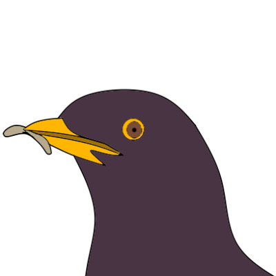
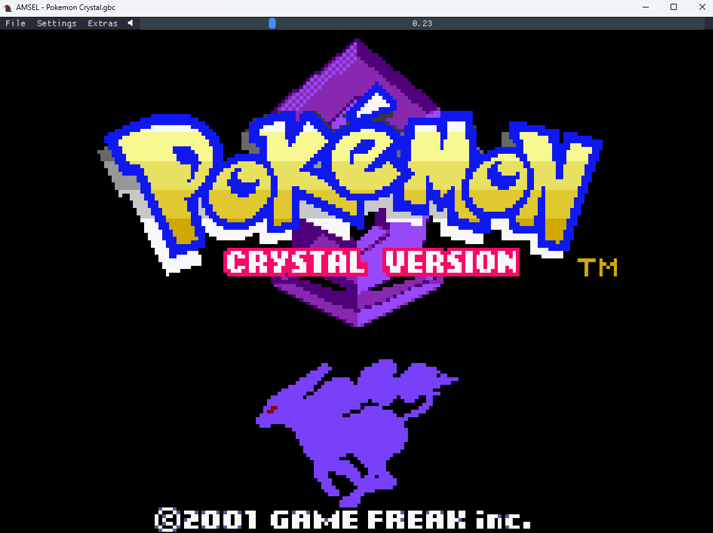
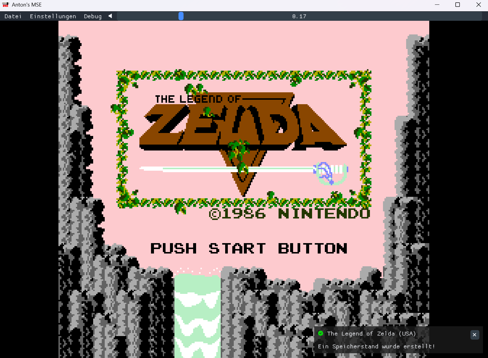
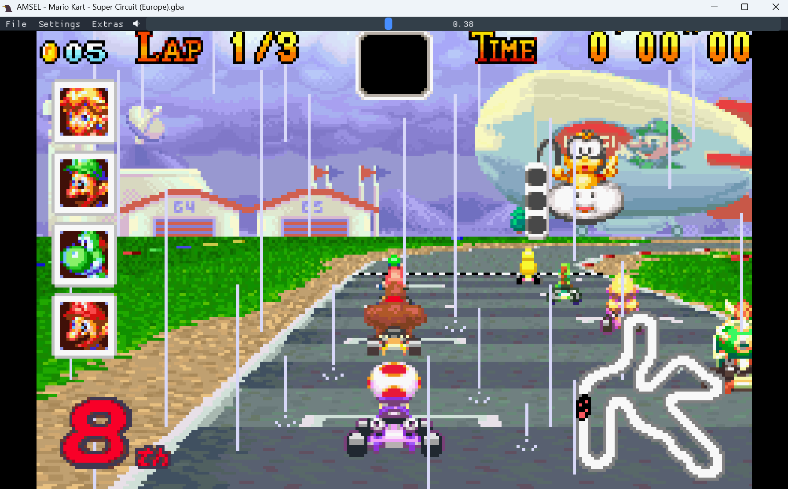
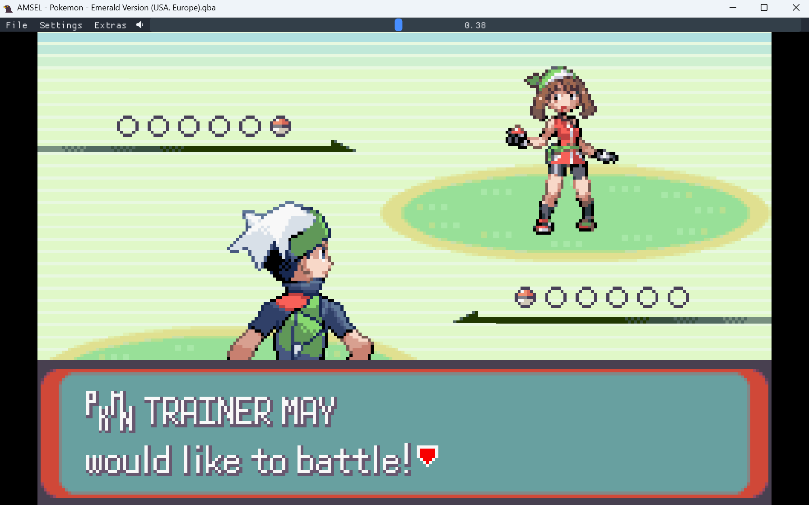
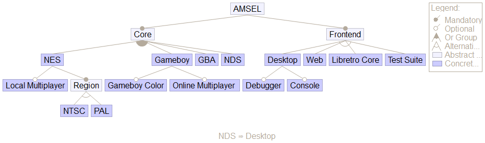

# Antons Multi-System-Emulator (AMSEL)

Cross-Plattform emulator product line in C++ (NES, DMG, CGB, GBA, NDS)

## <a href="https://aschmidt46.github.io/amsel/">Web-Demo</a>

   
   

## Systems and Compatibility
Every system comes with a built in debugger that is more or less feature-rich depending on my needs during development.
### Nintendo Entertainment System
- Behaviour was developed conforming to NTSC, added experimental PAL setting
- Most common Mappers implemented (MMC1, UxROM, CNROM, (MMC3), AxROM)
- MMC3 implementation is incomplete with simplified IRQ timing, some games have visual glitches
### Nintendo Gameboy Color (amd dmg)
- DMG games are in black and white
- Most mappers implemented (MBC1, MBC2, MBC3, MBC5)
- RTC is missing
- Some games require very strict DMA timing and don't work correctly because of it
- Link Cable Implementation over TCP, Master Gameboy experiences audio glitches because of latency
### Nintendo Gameboy Advance
- Passes ARMWrestler, arm.gba and thumb.gba by jsmolka, most SingleStepTests
- RTC implementation
- Plays most games that don't rely on obscure behaviour or precise timings
- Timings, Waitstates not implemented
- Performance is weak
### Nintendo DS
- Most peripherals are implemented
- firmware boots
- 2D engines have some functionality missing (extended affine modes, bitmap sprites)
- 3D engine WIP
- audio missing
- wifi missing
- Web frontend does not have support for touch input

## Features
- Persistent settings (Volume, keybinds, language, etc.)
- Persistent savegames
- Debugger / Disassembler
- Local multiplayer (NES)
- EXPERIMENTAL Online Multiplayer (Gameboy, Only on Desktop)
- Gamepad support
- CRT-Shader
- Localization using JSON files (german, english included)
- React web interface, includes smartphone layout

## Structure
The project is mostly written in C++. The individual consoles are decoupled from the interface, making the emulator easily extensible. Controls are now decoupled, with the system core needing to provide an interface that specifies number of controllers, buttons, mappings etc.. The number of buttons to be used is currently restricted to the ones in use by supported systems. Analog axes are not supported and mapped to on / off inputs. A System may also provide a touch screen surface, whose dimensions may be freely set. 
The desktop frontend is implemented in Dear ImGui, running in an OpenGL 4.5 context.

I implemented the gameboy emulator in a separate project at first to learn Rust, which is why it's written in that language. To include it here, I defined a FFI in Rust CXX. Using Corrosion in Cmake it's trivial to then include it in an existing C++ project.

The web app frontend is written in React / Typescript. The emulator defines a javascript interface and is then compiled using emscripten to webassembly.


The entire project is developed as a Software Product Line (SPL). Individual features are able to be set at configure time as CMake options to create valid products according to the feature model <a href="https://en.wikipedia.org/wiki/Feature_model">(see here)</a>. The solution space is realized as a mix of preprocessor annotations and build system to create variability.

# Build

requires CMake.
requires Python 3 for building glad.
requires Rust and Cargo for the Gameboy part.

Note: In MSVC, can only be built in release mode, because of an issue with rust debug level.
Note: Static linking of libstdc++23 (as is default on mingw) requires a new version of g++ / clang.

building:
```
cd build
python -m venv .venv
.venv/Scripts/activate.<ps1/bat/sh...>
python -m pip install jinja2
cmake ..
make
```
## building the web app

requires Emscripten and npm.

```
emcmake cmake .. -DFEATURE_WEB=ON -DFEATURE_DESKTOP=OFF
make
```
then in src/web:
```
npm install
npm run dev         (start dev server)
npm run build       (build website for delivery)
```

## building as Libretro core

On windows, has to be built with MSVC in order to work with standard releases of retroarch.

```
cmake .. -DFEATURE_LIBRETRO_CORE=ON -DFEATURE_DESKTOP=OFF
```

Then use appropriate build tool.

## running the tests

```
cmake .. -DFEATURE_TEST_SUITE=ON
make test
```

# Resources
System information / test roms that helped me immensely during development.

## NES
[NesDev Wiki](https://www.nesdev.org/wiki/NES_reference_guide)  
[6502 instruction reference](https://www.masswerk.at/6502/6502_instruction_set.html)  
[Blargg's APU reference](https://www.nesdev.org/apu_ref.txt)  
[NesDev Forums](https://forums.nesdev.org/) (many game-specific issues)  
[test roms](https://github.com/christopherpow/nes-test-roms)

## Gameboy
[gbdev pandocs](https://gbdev.io/pandocs/)  
[src/cgb/resources/Opcodes.json](https://gbdev.io/gb-opcodes/optables/)  
[SM83 instruction set reference](https://rgbds.gbdev.io/docs/v1.0.4/gbz80.7)  
[Blargg's test roms](https://github.com/retrio/gb-test-roms)  
[cgb-acid2 test rom](https://github.com/mattcurrie/cgb-acid2)

## GBA
[GBATEK](https://problemkaputt.de/gbatek.htm)  
[ARM7TDMI Datasheet](https://www.dwedit.org/files/ARM7TDMI.pdf)  
[TONC](https://www.coranac.com/tonc/text/) (ppu explanation + test roms)  
[Explaining GBA Real-Time Clock](https://bmchtech.github.io/post/rtc/)  
[Notes on GBA PPU: Windows and Blending](https://raddad772.github.io/2025/01/02/notes-on-GBA-PPU-windows-and-blending.html)  
[Cartridge Backup Storage](https://dillonbeliveau.com/2020/06/05/GBA-FLASH.html)  
[ARM7TDMI single-step tests](https://github.com/SingleStepTests/ARM7TDMI)  
[armwrestler test rom](https://github.com/destoer/armwrestler-gba-fixed)  
[jsmolka test suite](https://github.com/jsmolka/gba-tests)  
[mGBA test suite](https://github.com/mgba-emu/suite)

## NDS
\+ everything from gba  
[GBATEK](https://problemkaputt.de/gbatek.htm)  
[GBATEK addendum](https://melonds.kuribo64.net/board/thread.php?pid=6560)  
[Living on the Edge](https://hydr8gon.github.io/noods/2021/01/15/living-on-edge.html)  
[Nintendo DS Geometry and Rendering Engine notes](https://raddad772.github.io/2025/03/14/nds_ge_re_basics.html)  
[MelonDS Blog + Forums](https://melonds.kuribo64.net)  
[Shonumi Blog](https://shonumi.github.io/blog/nds_rolling.html)  
[libnds examples](https://github.com/devkitPro/nds-examples) (+ calico source code)  
[blocksds examples](https://codeberg.org/blocksds/sdk)  
[rockwrestler test rom](https://github.com/RockPolish/rockwrestler)  
[armwrestler test rom](https://github.com/Atem2069/armwrestler-fixed)

# License
AMSEL is licensed under BSD-3.
Parts of the nes ppu code were taken and edited from olcNES (<a href="https://github.com/OneLoneCoder/olcNES#license-olc-3">see license</a>).
